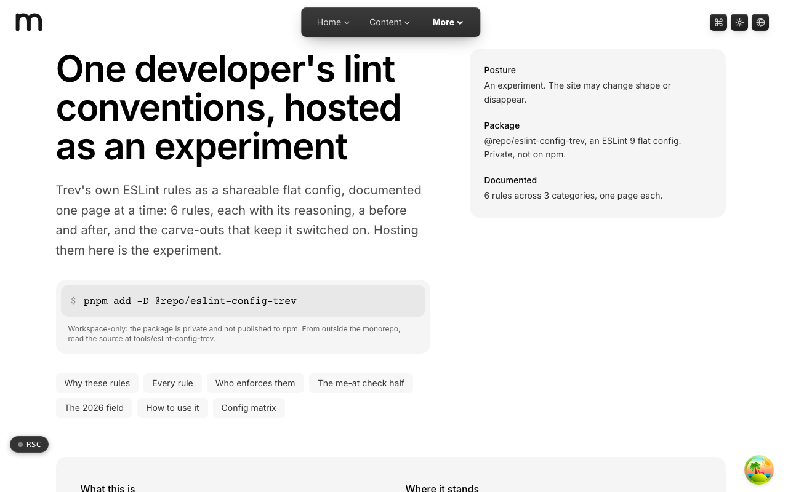
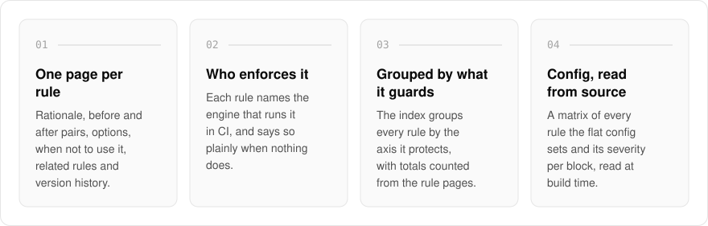
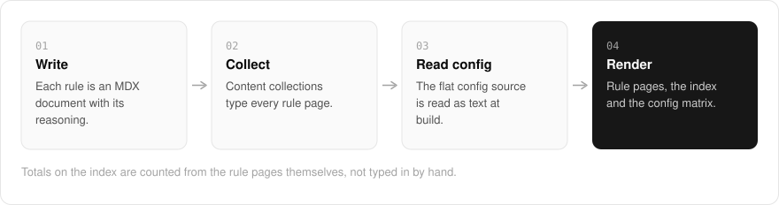
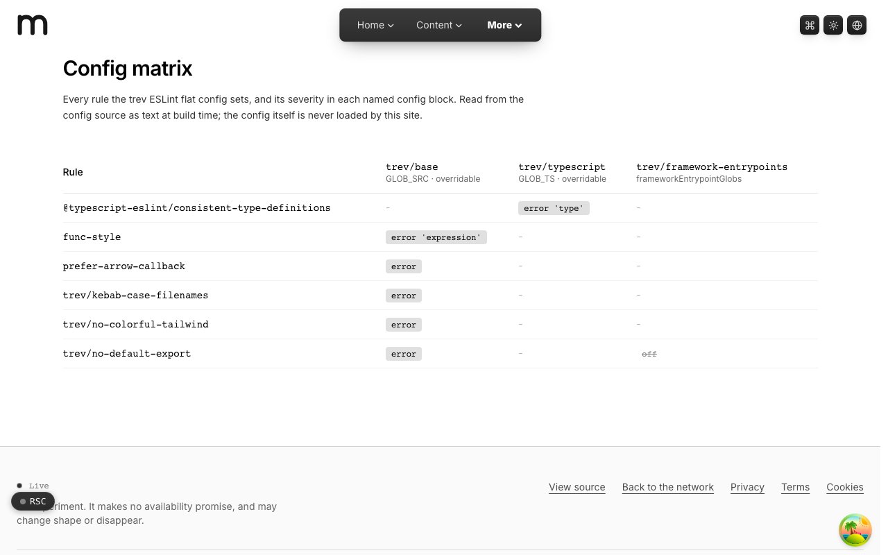
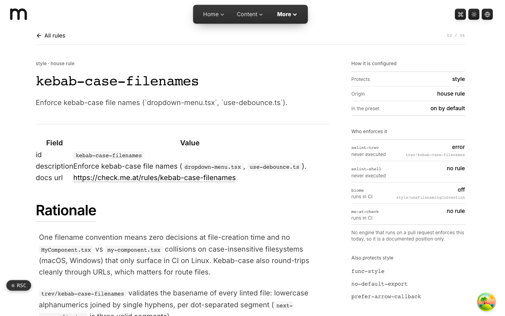
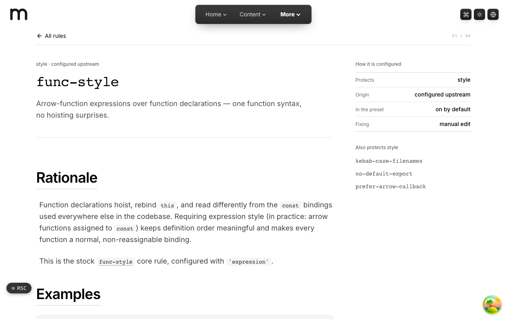
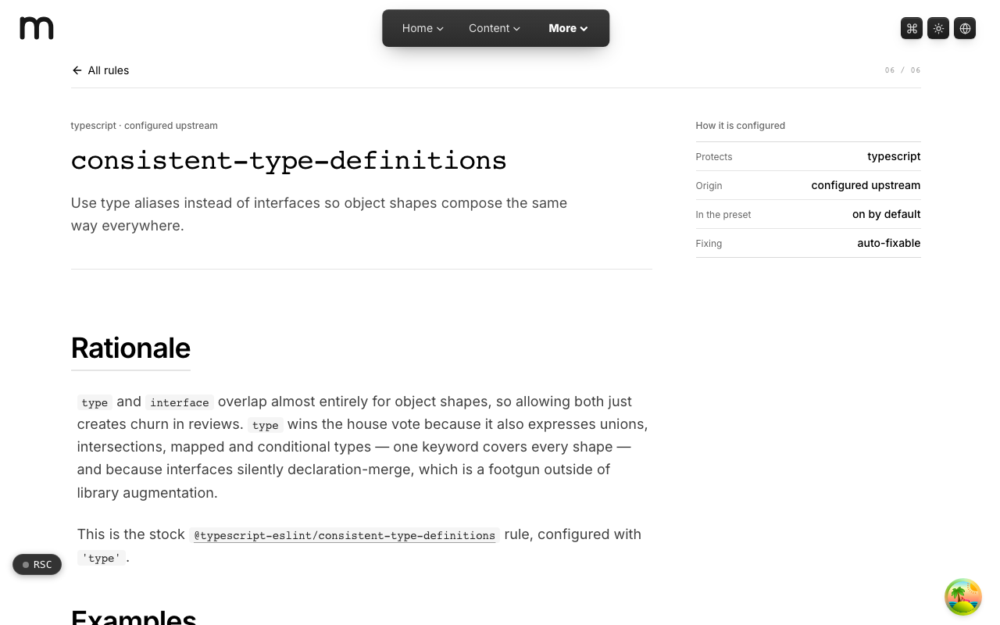

  <picture>
    <source media="(prefers-color-scheme: dark)" srcset=".github/assets/hero-dark.png">
    
  </picture>

<h1 align="center">check.me.at</h1>

<strong>My linting conventions, one rule at a time, with the reasoning.</strong>

  
  
  

  <a href="#features">Features</a> ·
  <a href="#how-it-works">How it works</a> ·
  <a href="#screenshots">Screenshots</a> ·
  <a href="#built-with">Built with</a>

A red lint run tells you what broke, but rarely why the rule exists. I built check.me.at to document the house conventions I enforce across ESLint, Biome and `me-at check` (my monorepo's own workspace checker). Each rule in my shared ESLint 9 flat config gets its own page with its reasoning, a before and after, and the carve-outs that keep it switched on. It is for anyone curious why my codebase is shaped the way it is, and for contributors who want the reasoning behind a failing check.

  <picture>
    <source media="(prefers-color-scheme: dark)" srcset=".github/assets/overview-dark.svg">
    
  </picture>

## Why check.me.at

| The usual lint config | check.me.at |
| --- | --- |
| A list of rule names and severities | A page per rule with the reasoning, examples and carve-outs |
| You guess which tool runs a rule | Each rule names the engine that enforces it in CI, or says nothing does |
| Rules in one long file | Rules grouped by the axis they protect, with counted totals |
| Docs that drift from the config | A severity matrix read from the config source at build time |

## Features

- **One page per rule**: rationale, example pairs, options, when not to use it, related rules, and version history, rendered from MDX.
- **Rules grouped by what they protect**: the index groups every rule by the axis it guards (style, TypeScript, and more), with totals counted from the rule pages themselves.
- **Who enforces it**: each rule shows which engine (the ESLint preset, Biome, or `me-at check`) actually runs it in CI, and says so plainly when nothing does.
- **Config matrix**: every rule the flat config sets and its severity in each named config block, read from the config source as text at build time.
- **The me-at check half**: an overview of the repository-wide checker, where rules read every app's manifest and need no config file.
- **The field**: a survey of the lint and format tools around the preset, showing which ones run on every pull request here.
- **Light and dark themes** across every page.

## How it works

  <picture>
    <source media="(prefers-color-scheme: dark)" srcset=".github/assets/flow-dark.svg">
    
  </picture>

Every rule is written as an MDX document, and content collections check each one against the same schema before the site builds. At build time the flat config source is read as text to produce the severity matrix, so the published config view cannot drift from the real one. The rule pages, the grouped index and the matrix all render from those two sources.

## Screenshots

<table>
  <tr>
    <td width="50%"><picture><source media="(prefers-color-scheme: dark)" srcset=".github/assets/config-dark.png"></picture> Config matrix: every rule and its severity per config block.</td>
    <td width="50%"><picture><source media="(prefers-color-scheme: dark)" srcset=".github/assets/rules--kebab-case-filenames-dark.png"></picture> kebab-case-filenames: a house rule and who enforces it.</td>
  </tr>
  <tr>
    <td width="50%"><picture><source media="(prefers-color-scheme: dark)" srcset=".github/assets/rules--func-style-dark.png"></picture> func-style: the rationale for arrow-function expressions.</td>
    <td width="50%"><picture><source media="(prefers-color-scheme: dark)" srcset=".github/assets/rules--consistent-type-definitions-dark.png"></picture> consistent-type-definitions: type aliases over interfaces.</td>
  </tr>
</table>

## Built with

  
  
  
  
  
  
  

- Next.js 16 (App Router), React 19, TypeScript
- Tailwind CSS 4
- MDX rule documents through content collections
- ESLint 9 flat config, Biome

## Part of the me.at family

check.me.at is one of my [`*.me.at`](https://me.at) apps. They share one design system, account, and app shell. Development happens in a private monorepo; this repository is the project's public-facing home.

## License

Source-available. See [LICENSE](LICENSE).
